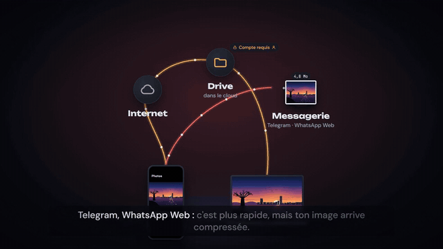

# LocalDrop

Partage de fichiers entre un PC Windows et un smartphone (Android ou iPhone) **sur le réseau local**, sans cloud, sans compte et sans application à installer sur le téléphone.

**Scanner, connecter, transférer.**

<p align="center">
  <a href="docs/media/localdrop-presentation.mp4">
    
  </a>
  <br>
  <a href="docs/media/localdrop-presentation.mp4"><b>▶ Voir la vidéo de présentation (1 min, avec le son)</b></a>
</p>

- [Comment fonctionne l'application](#comment-fonctionne-lapplication)
- [Créer le fichier exécutable](#créer-le-fichier-exécutable-localdropexe)
- [Développer sur le projet](#développer-sur-le-projet)
- [Documentation](#documentation)

---

## Comment fonctionne l'application

### Le principe

LocalDrop s'installe **uniquement sur le PC**. Au lancement, il démarre un petit serveur web local. Le téléphone s'y connecte avec son navigateur habituel (Chrome, Safari…) en scannant un QR Code. Les fichiers passent directement du téléphone au PC (ou l'inverse) par le Wi-Fi, sans jamais sortir de votre réseau.

```
 ┌──────────────── PC Windows ────────────────┐          ┌──── Téléphone ────┐
 │  LocalDrop.exe                             │          │                   │
 │   ├─ fenêtre (QR Code, appareils,          │  Wi-Fi   │  Navigateur       │
 │   │  transferts, historique, paramètres)   │◄────────►│  (page LocalDrop) │
 │   └─ serveur local (HTTP + WebSocket)      │  local   │                   │
 │        ├─ base SQLite (historique)         │          └───────────────────┘
 │        └─ dossier Téléchargements\LocalDrop│
 └────────────────────────────────────────────┘
```

### Le parcours d'un utilisateur

1. **Lancer LocalDrop sur le PC.** La fenêtre affiche un QR Code.
   - Au premier lancement, Windows demande l'accès au réseau : cochez **Réseaux privés**.
2. **Mettre le téléphone sur le même réseau** que le PC : même Wi-Fi, ou point d'accès mobile du PC ou du téléphone. Les données 4G/5G ne fonctionnent pas.
3. **Scanner le QR Code** avec l'appareil photo du téléphone : la page LocalDrop s'ouvre dans le navigateur.
4. **Autoriser le téléphone sur le PC.** Une fenêtre « Nouvel appareil » s'ouvre ; cliquez sur **Autoriser** si c'est bien votre téléphone. Le téléphone affiche alors « Connecté à <nom du PC> ».
5. **Transférer** :
   - **du téléphone vers le PC** : *Envoyer* → *Choisir des fichiers*. Les fichiers arrivent dans `Téléchargements\LocalDrop` ;
   - **du PC vers le téléphone** : glissez des fichiers dans la fenêtre du PC, puis sur le téléphone : *Recevoir* → *Télécharger* → *J'ai reçu le fichier*.
6. **Consulter l'historique** sur le PC ou sur le téléphone (onglet *Historique*).

Le guide complet pour les utilisateurs, avec le dépannage réseau, est dans [docs/guide-utilisateur.md](docs/guide-utilisateur.md).

### Ce qui se passe en coulisses

- **Appairage sécurisé**
  - Le QR Code contient un secret à **usage unique**, qui expire au bout de 5 minutes.
  - Chaque nouveau téléphone doit être **autorisé sur le PC**. Il reçoit alors un jeton personnel, révocable à tout moment (*Déconnecter*, *Fermer la session*).
- **Transfert par blocs**
  - Les fichiers sont découpés en blocs de 4 Mio.
  - Chaque bloc est vérifié par son empreinte **SHA-256** puis écrit durablement sur le disque. Le fichier entier est vérifié à la fin.
  - Un fichier n'apparaît dans le dossier de réception qu'une fois **complet et vérifié**. Il n'écrase jamais un fichier existant : le nouveau devient `photo (1).jpg`.
- **Reprise après coupure**
  - Si le Wi-Fi coupe, si la page se ferme ou si le PC redémarre, seuls les blocs manquants sont renvoyés.
  - Les envois inachevés sont conservés 24 h.
- **Temps réel** : la progression s'affiche en direct des deux côtés (WebSocket).
- **Réseau local uniquement**
  - Le serveur n'écoute que sur les adresses privées du PC et refuse tout client extérieur.
  - Il détecte un changement de réseau, par exemple l'activation du point d'accès, et affiche alors un nouveau QR Code.
- **Données** :

  | Quoi | Où |
  |---|---|
  | Fichiers reçus | `%USERPROFILE%\Downloads\LocalDrop` (modifiable dans les Paramètres) |
  | Base, journaux, paramètres | `%LOCALAPPDATA%\LocalDrop` |

> **Attention.** La connexion locale n'est pas chiffrée (HTTP). Utilisez un réseau de confiance (domicile, point d'accès personnel) et **évitez les Wi-Fi publics**.

---

## Créer le fichier exécutable (`LocalDrop.exe`)

À partir du code source, une seule commande produit une archive prête à distribuer. Elle contient `LocalDrop.exe`, qui fonctionne sur n'importe quel PC Windows 10 ou 11 64 bits sans Python ni Node.js.

### Étape 1 : installer les outils (une seule fois)

| Outil | Version | Vérification | Téléchargement |
|---|---|---|---|
| Windows | 10 ou 11, 64 bits | | |
| Python | **3.12** ou 3.13 | `py -3.12 --version` | <https://www.python.org/downloads/> |
| Node.js | 20.19+ ou 22 LTS (npm inclus) | `node --version` | <https://nodejs.org/> |
| Git | n'importe laquelle | `git --version` | <https://git-scm.com/> |

Si une autre version de Python est installée par défaut (par exemple la 3.10), elle ne convient pas. Utilisez toujours `py -3.12` comme ci-dessous.

### Étape 2 : récupérer le code et installer les dépendances (une seule fois)

Dans PowerShell :

```powershell
git clone <adresse du dépôt> LocalDrop
cd LocalDrop

# Environnement Python isolé, avec les outils de test et PyInstaller
py -3.12 -m venv .venv
.venv\Scripts\pip install -r requirements-dev.txt

# Dépendances de l'interface mobile
npm --prefix apps/web ci
```

### Étape 3 : construire

```powershell
.venv\Scripts\python scripts\build_windows.py
```

Le script s'arrête à la moindre erreur. Il enchaîne six étapes, en 3 à 4 minutes environ :

| # | Étape | Rôle |
|---|---|---|
| 1 | Interface web | Compile la page du téléphone (`apps/web/dist`) |
| 2 | Qualité et tests | Lance ruff, mypy, pytest et les tests web : rien n'est construit si un test échoue |
| 3 | PyInstaller | Crée `dist\LocalDrop\LocalDrop.exe` à partir de [localdrop.spec](localdrop.spec) |
| 4 | Autotest | Lance l'exécutable lui-même (`--self-test`) : page web, base, serveur, transferts, interface |
| 5 | Test de fumée | Ouvre la vraie application, appaire un faux téléphone, transfère dans les deux sens, ferme, relance |
| 6 | Archive | Produit `dist\LocalDrop-<version>-windows-x64.zip` et son empreinte `.sha256` |

Options :

- `--skip-checks` saute l'étape 2 (plus rapide, déconseillé pour une version publiée) ;
- `--clean-web` réinstalle les dépendances web avant de compiler.

### Étape 4 : récupérer le résultat

```
dist\
├── LocalDrop\                               ← application prête à lancer
│   ├── LocalDrop.exe
│   └── _internal\                           ← indispensable, à garder à côté de l'exe
├── LocalDrop-1.0.0rc1-windows-x64.zip       ← archive à distribuer (≈ 60 Mo)
└── LocalDrop-1.0.0rc1-windows-x64.zip.sha256
```

Pour distribuer, envoyez l'archive zip, qui contient aussi le guide `LISEZ-MOI.md`. L'utilisateur la décompresse et lance `LocalDrop.exe` : rien d'autre à installer.

### Vérifier un exécutable

Sur n'importe quel PC, dans une invite de commandes ouverte dans le dossier `LocalDrop` :

```bat
start /wait LocalDrop.exe --self-test
echo %ERRORLEVEL%
```

`0` signifie que tout fonctionne. Le détail est dans `%TEMP%\localdrop-selftest.json`. Ce test n'utilise ni les données de l'utilisateur ni le réseau.

### Construire étape par étape (sans le script)

```powershell
npm --prefix apps/web run build                                  # 1. page du téléphone
.venv\Scripts\pytest                                             # 2. tests
.venv\Scripts\pyinstaller localdrop.spec --noconfirm --clean     # 3. exécutable -> dist\LocalDrop\
start /wait dist\LocalDrop\LocalDrop.exe --self-test rapport.json  # 4. autotest
.venv\Scripts\python scripts\smoke_test_exe.py                   # 5. test de l'application réelle
```

### En cas de problème

| Symptôme | Solution |
|---|---|
| `Interface web non compilée` | Lancez `npm --prefix apps/web run build`, ou utilisez le script complet. |
| `'npm' n'est pas reconnu` | Installez Node.js, puis rouvrez PowerShell. |
| `No module named ...` ou mauvaise version de Python | Recréez l'environnement avec `py -3.12 -m venv .venv`, puis réinstallez `requirements-dev.txt`. |
| L'autotest échoue | Lisez le rapport JSON (le champ `detail` de l'étape en échec). Une ressource ou un module manque probablement dans `localdrop.spec` : voir [docs/packaging.md](docs/packaging.md). |
| L'antivirus bloque ou supprime l'exe | C'est un faux positif fréquent avec PyInstaller : ajoutez une exclusion pour le dossier `dist`. |
| « Windows a protégé votre ordinateur » au lancement | L'exécutable n'est pas signé : *Informations complémentaires* → *Exécuter quand même*. |

**Changer la version** : modifiez `backend/src/localdrop/__init__.py` **et** `pyproject.toml` (un test vérifie qu'ils correspondent), ainsi que `apps/web/package.json`. La liste de contrôle avant publication est dans [docs/packaging.md](docs/packaging.md).

---

## Développer sur le projet

### Lancer depuis les sources (sans construire l'exécutable)

```powershell
.venv\Scripts\python -m localdrop_desktop     # application Windows complète
.venv\Scripts\python -m localdrop             # serveur seul, QR Code affiché dans le terminal
```

L'interface web doit avoir été compilée au moins une fois (`npm --prefix apps/web run build`). Pour développer la page mobile avec rechargement à chaud : `npm --prefix apps/web run dev` (les appels `/api` et `/ws` sont redirigés vers le serveur local).

### Qualité et tests

```powershell
.venv\Scripts\ruff check . ; .venv\Scripts\ruff format --check . ; .venv\Scripts\mypy
.venv\Scripts\pytest                          # tous les tests Python (unitaires, intégration, bout en bout)

npm --prefix apps/web run lint
npm --prefix apps/web run typecheck
npm --prefix apps/web test
```

- `pytest tests/e2e` comprend des tests sur de vrais sockets et dans un vrai navigateur (Chrome ou Edge sans interface).
- `python -m localdrop.bench` mesure le débit selon la taille des blocs.

### Technologies

| Partie | Technologies |
|---|---|
| Serveur | Python 3.12, FastAPI, Uvicorn, SQLAlchemy 2, Alembic, SQLite |
| Application Windows | PySide6 (Qt) |
| Page du téléphone | React 19, TypeScript, Vite, Tailwind CSS, Zod |
| Exécutable | PyInstaller (mode dossier, voir [ADR-008](docs/decisions/ADR-008-distribution-windows.md)) |

### Structure

```
backend/src/localdrop/                serveur (api, services, domain, infrastructure)
apps/desktop/src/localdrop_desktop/   application Windows PySide6
apps/web/                             page du téléphone (React + TypeScript)
migrations/                           évolutions de la base (Alembic)
localdrop.spec, packaging/            recette PyInstaller, point d'entrée, icône
scripts/                              construction et test de fumée de l'exécutable
tests/                                tests d'intégration et de bout en bout
docs/                                 guides, décisions, sécurité, tests
```

---

## Documentation

| Document | Pour qui |
|---|---|
| [Guide utilisateur](docs/guide-utilisateur.md) | Utilisateurs : installation, utilisation, dépannage |
| [Construire et publier](docs/packaging.md) | Mainteneurs : construction détaillée, liste de contrôle de publication |
| [Cahier des charges](LocalDrop_Cahier_des_charges_Architecture.md) | Exigences et architecture de référence |
| [Décisions d'architecture (ADR)](docs/decisions/) | Choix techniques et leurs raisons |
| [Audit de sécurité](docs/security/audit-phase-10.md) | Modèle de menace, mesures, risques résiduels |
| [Matrice de tests](docs/testing/e2e-matrix.md) | Tests automatisés et tests manuels avec téléphones |
